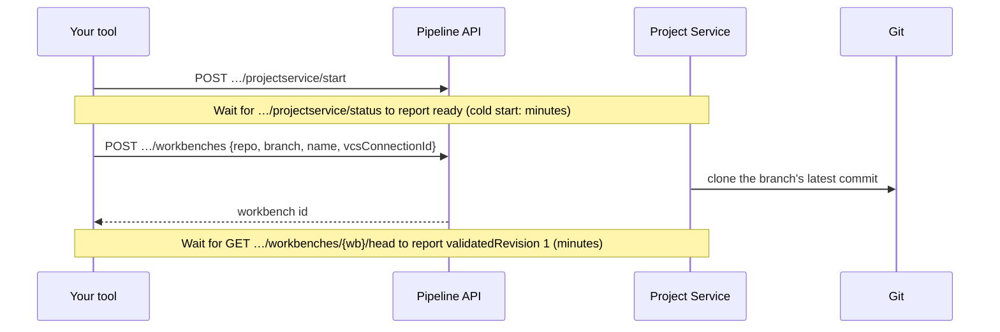
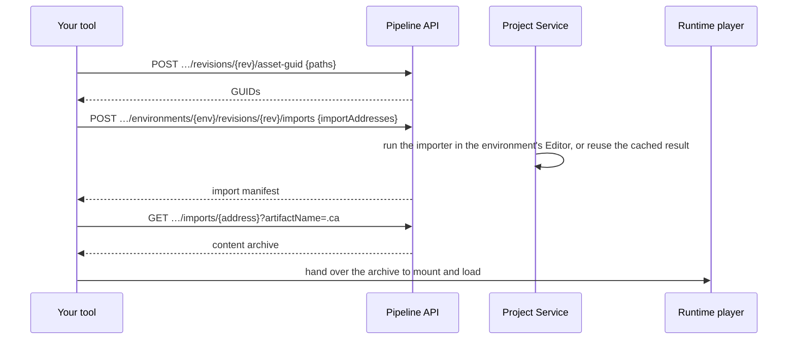
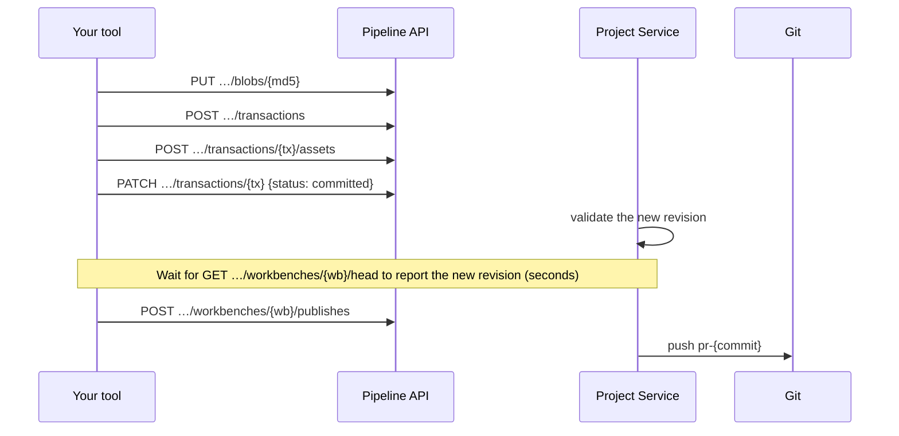

# Architecture

This page shows the parts involved when a tool or a player works with a Unity project through the Pipeline API, then the three request flows you use most. It's a view built from the API's observable behavior. Project Service's internal implementation can differ.

## Overview

| Part | Role |
| --- | --- |
| **Your tool** | Any code that calls the REST API with a Unity bearer token: a C# service, a script, a DCC add-on. |
| **Runtime player** | Your player build. It contains code and runtime shaders; scenes and assets arrive as content archives (`.ca`). |
| **Pipeline API** | The single entry point: `…/organizations/{org}/projects/{project}/…`. Starting Project Service is the one call that goes to a separate host. Refer to [Get started](get-started.md#start-project-service). |
| **Workbench** | A working copy of one git branch at one commit. Revision 1 is the checkout, and every commit adds a revision. Refer to [Key concepts](key-concepts.md#workbench). |
| **Environment** | A Unity Editor running the project for one build profile (platform). Imports run here, so their output matches what a player on that platform loads. |
| **Artifact cache** | Import results, keyed by revision, environment and import address. Repeating an import at the same revision is fast. |
| **Git repository** | Where a workbench is cloned from, and where publishing pushes a `pr-{commit}` branch. |
| **Build Automation** | Holds the VCS connection, the git credentials a workbench needs to publish. Pass its ID as `vcsConnectionId` when you create the workbench. |

## Flow 1: Start working on a branch (2 calls, then wait)

A workbench stays on the commit it was created from. To work from newer commits, create a new workbench. Refer to [Troubleshooting](troubleshooting.md#a-workbench-doesnt-have-the-latest-commits).

## Flow 2: Get an asset into a player (3 calls)

The first import of an asset at a revision can take minutes, and a scene compiles every shader variant its materials need. Re-send the request until it answers with a manifest. Refer to [Preview assets in a runtime player](use-case-preview-assets.md) and [Play whole scenes from content archives](use-case-scene-archives.md).

## Flow 3: Save a change and publish it (5 calls, then wait)

Merge the `pr-{commit}` branch into your branch like any other. Refer to [Edit a project](use-case-edit-a-project.md) and [Publish workbench changes to git](publish-to-git.md).

## What lives where

| In your player build | In content archives |
| --- | --- |
| Scripts (IL2CPP can't load code at runtime) | Meshes, textures, materials, prefabs |
| Shaders the render pipeline looks up at runtime, such as terrain detail shaders | Shaders the archived materials use, with the variants their scene needs |
| Graphics settings, including which fog and lightmap variants are kept | Whole scenes, with their lighting settings and objects |

This split is why a player that loads archives stays generic: it ships the code and runtime shaders once, and every scene or asset comes from Project Service. Refer to [Keep the player generic](use-case-scene-archives.md#keep-the-player-generic).

## Additional resources

* [Key concepts](key-concepts.md)
* [Get started with the Pipeline API](get-started.md)
* [Troubleshooting](troubleshooting.md)
