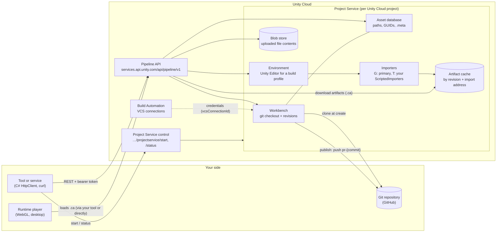
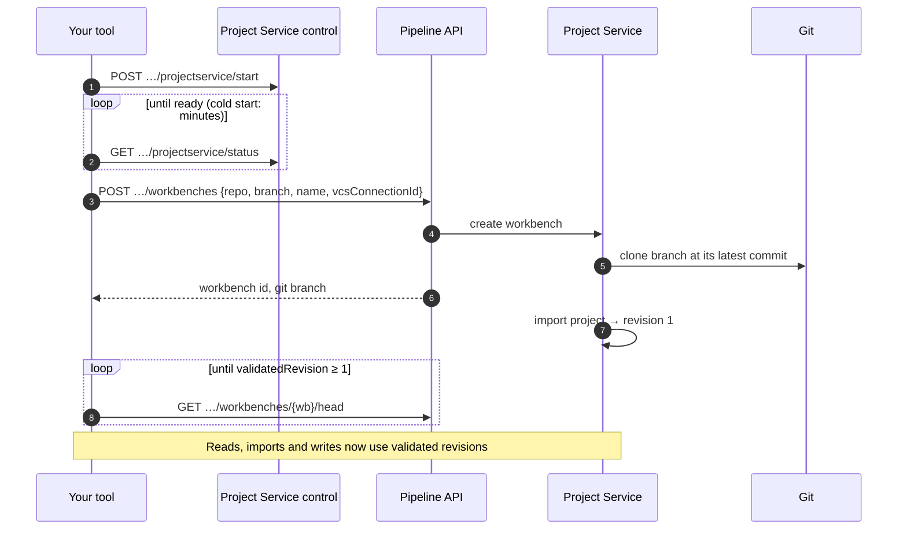
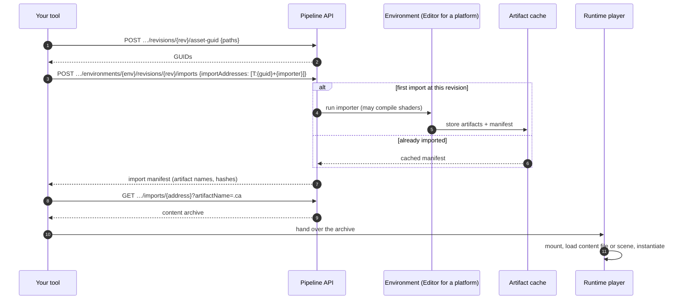
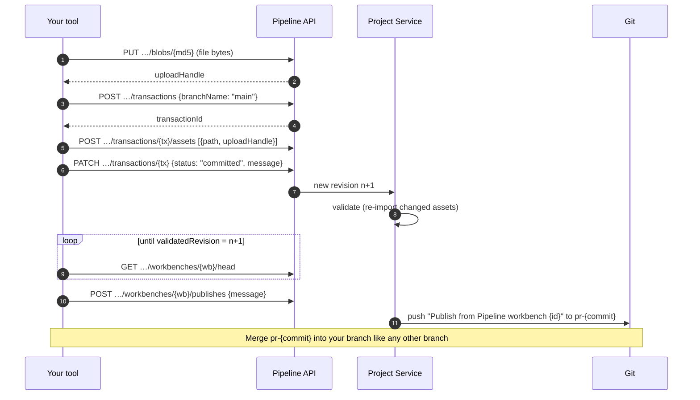

# Architecture

This page shows the components involved when a tool or a player works with a Unity project through the Pipeline API, and how requests flow between them. It's a logical view built from the API's observable behavior: Project Service's internal implementation can differ.

## Components

| Component | Role |
| --- | --- |
| **Pipeline API** | The REST surface: `…/organizations/{org}/projects/{project}/…`. Every call takes a Unity bearer token. |
| **Project Service control** | Starts and reports on the project's Project Service. Project Service idles out when unused, and workbench calls fail until it's started again. |
| **Workbench** | A working copy of one git branch at one commit. It holds the project's revisions: revision 1 is the checkout, and every commit adds one. Refer to [Key concepts](key-concepts.md#workbench). |
| **Asset database** | The imported project's index: file tree, GUIDs, `.meta` files and dependencies, per revision. |
| **Blob store** | Holds uploaded file contents until a transaction binds them to paths. |
| **Environment** | A Unity Editor running the project for one build profile (platform). Imports run here, so their output matches what a player on that platform loads. |
| **Importers** | `G:{guid}` runs an asset's primary importer. `T:{guid}+{type}` runs a specific importer, such as your own non-primary `ScriptedImporter`. |
| **Artifact cache** | Import results, keyed by revision, environment and import address. A repeated import at the same revision is served from here. |
| **Build Automation** | Owns VCS connections: the git credentials a workbench uses to publish. |
| **Runtime player** | Your player build. It contains code and shaders; scenes and assets arrive as content archives. |

## Lifecycle of a workbench

A workbench stays on the commit it was created from. To work from newer commits, create a new workbench. Refer to [Troubleshooting](troubleshooting.md#a-workbench-doesnt-have-the-latest-commits).

## Reading and importing

The first import of an asset at a revision can take minutes, because the environment's Editor imports it, and a scene compiles every shader variant its materials need. Re-send the request until it answers with a manifest. Refer to [Preview assets in a runtime player](use-case-preview-assets.md) and [Play whole scenes from content archives](use-case-scene-archives.md).

## Writing and publishing

Refer to [Edit a project](use-case-edit-a-project.md) and [Publish workbench changes to git](publish-to-git.md).

## What lives where

| Lives in your player build | Arrives in content archives |
| --- | --- |
| Scripts (IL2CPP can't load code at runtime) | Meshes, textures, materials, prefabs |
| Shaders the render pipeline looks up at runtime, such as terrain detail shaders | Shaders the archived materials use, with the variants their scene needs |
| Graphics settings, including which fog and lightmap variants are kept | Whole scenes, with their lighting settings and objects |

This split is why a player that loads archives stays generic: it ships the code and runtime shaders once, and every scene or asset comes from Project Service. Refer to [Keep the player generic](use-case-scene-archives.md#keep-the-player-generic).

## Additional resources

* [Key concepts](key-concepts.md)
* [Get started with the Pipeline API](get-started.md)
* [Troubleshooting](troubleshooting.md)
